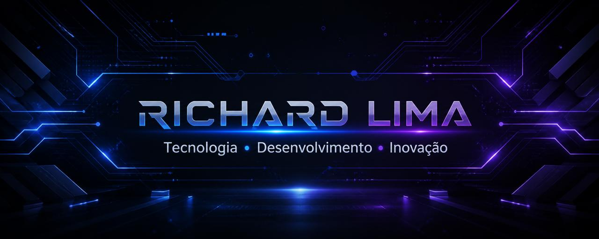

<p align="center">
  
</p>

<h1 align="center">Olá! Eu sou o Richard Lima 👋</h1>

<p align="center">
  💻 Desenvolvimento &nbsp;•&nbsp; 🖥️ Infraestrutura de TI &nbsp;•&nbsp; ⚙️ Automação &nbsp;•&nbsp; 🚀 Tecnologia
</p>

<p align="center">
  <a href="https://www.linkedin.com/in/richard-lima-887b563b3/">
    
  </a>
  <a href="https://github.com/richardlimax">
    
  </a>
</p>

---

## 👨‍💻 Sobre mim

Sou estudante da área de tecnologia e atualmente venho desenvolvendo minha experiência tanto em **desenvolvimento de software** quanto em **infraestrutura de TI**.

No dia a dia, busco unir programação, infraestrutura, redes e automação para criar soluções que realmente facilitem processos e resolvam problemas.

Tenho interesse constante em aprender novas tecnologias, desenvolver projetos próprios e transformar ideias em soluções funcionais.

* 🎓 Estudante da área de Tecnologia
* 💻 Interesse em desenvolvimento de sistemas e aplicações web
* 🖥️ Experiência prática com infraestrutura de TI
* 🌐 Conhecimentos em redes e ambientes computacionais
* ⚙️ Interesse em automação de processos
* 🤖 Explorando Inteligência Artificial aplicada ao desenvolvimento
* 🚀 Sempre buscando novos projetos e desafios

---

## 🛠️ Tecnologias e Ferramentas

### 💻 Desenvolvimento

<p>
  
</p>

### 🔧 Ferramentas

<p>
  
</p>

### 🖥️ Infraestrutura & TI

`Redes` • `Servidores` • `Hardware` • `Suporte Técnico` • `Inventário de TI` • `Automação`

---

## 🚀 Projetos em destaque

### 📊 Marketplace | Acompanhamento do Projeto

Painel oficial de acompanhamento do projeto semestral de Banco de Dados, criado para organizar etapas, responsáveis, prazos e entregas da equipe.

🔗 [Acessar painel](https://marketplace-bd-2026.github.io/painel/)  
🔗 [Ver repositório](https://github.com/marketplace-bd-2026/painel)

`Em desenvolvimento`

### 💻 Algoritmos e Pensamento Computacional

Repositório com os códigos desenvolvidos nas aulas 2 a 10 da disciplina de Algoritmos e Pensamento Computacional, utilizando a linguagem C.

🔗 [Ver projeto no GitHub](https://github.com/Richardlimax/algoritmos-pensamento-computacional)

---

## 🎯 Áreas de Interesse

```text
💻 Desenvolvimento de Software
🌐 Desenvolvimento Web
🖥️ Infraestrutura de TI
🔌 Redes e Servidores
⚙️ Automação
🤖 Inteligência Artificial
📊 Sistemas de Gestão
```

---

## 📊 Estatísticas do GitHub

<p align="center">
  
</p>

<p align="center">
  
</p>

---

## 🌐 Vamos nos conectar?

<p align="center">
  Estou sempre aberto a trocar experiências, aprender coisas novas e conhecer pessoas da área de tecnologia.
</p>

<p align="center">
  <a href="https://www.linkedin.com/in/richard-lima-887b563b3/">
    
  </a>
  <a href="https://github.com/richardlimax">
    
  </a>
</p>

---

<p align="center">
  <i>"Transformando aprendizado em projetos e ideias em soluções."</i>
</p>
